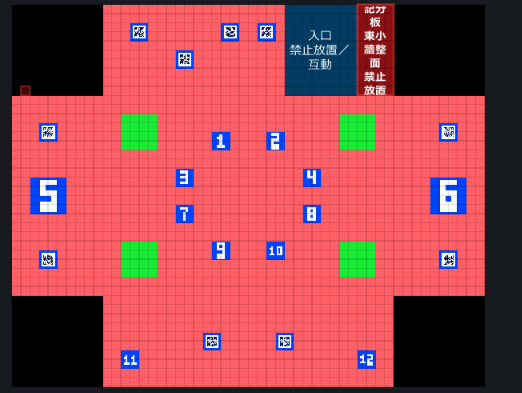

# 數字字形、場域輸出方向與 CAVE 左牆修正规劃

日期：2026-10-13（Asia/Taipei）｜版本：v1.3｜狀態：字形與方向修正已實作；最新隔離 ProductionVerification 163 項通過，正式專案腳本編譯成功；Player 與實體場域待驗收

適用專案：`C:/Users/momou/Desktop/Task/Research/Claude/ScanPro704`。

本文件依使用者回報與目前原始碼整理。使用者先要求只提供規劃，之後明確要求「請依規劃文件製作」；以下保留原規劃，並記錄後續實作及實測狀態。

## 2026-10-13 依實際投影回報修正方向驗證

- 使用者確認實際 CAVE 投影後數字方向仍錯，並指定「依附圖的位置判斷」右牆作為正向參考。驗收視角定義為觀眾站在 Floor 內側看向四面牆，牆上數字需正向可讀。
- 回查 2026-10-12 的 `NumberCaveVerification` 50 項與 `ProductionVerification` 151 項：當時的方向測試沒有把最終 atlas shader 的各面映射與 Floor 觀眾視角串起來，因此不能作為實際投影方向已驗收的依據。舊結果保留為歷史記錄，以下列 10/13 測試為準。
- 依 Face 4 右牆的方向調整其餘輸出牆面文字旋轉；Face 0、1、3 的最終 atlas 標記方向與 Face 4 一致。CAVE 預覽改用最終 atlas 紋理逐面渲染，並從 Floor 內側呈現四牆，讓預覽遵循與場域輸出相同的面映射。
- Unity 2022.3.62f3 隔離副本 GPU `ProductionVerification` **163 項通過（exit 0）**。新增檢查包含 shader 實際產出的 atlas Face 0／1／3 對照 Face 4，以及從 Floor 觀眾視角檢查左、前、後、右牆的非對稱 `12` 標記方向；畫面證據與逐項報告見 `TestResults/CaveProjectionFix_20261013/Artifacts/`、`Sandbox/TestResults/production-checks.txt`。
- 正式 `ScanPro704` 專案以 Unity 2022.3.62f3 batch mode 完成腳本編譯與 domain reload，exit 0，沒有 C# 編譯錯誤；log 為 `TestResults/CaveProjectionFix_20261013/official-project-compile.log`。
- **限制**：沒有建置 Player，沒有連接實際 TouchService、掃碼機或實體投影設備。隔離 GPU 結果及正式專案編譯都不等於 Player／場域驗收；仍須在實際投影逐面確認。

## 1. 要達到的結果

| 項目 | 預期結果 |
| --- | --- |
| 自動填入數字的形狀 | 數字清楚、比例一致；2、5、6、9 的底線與字身分離，大小格、雙位數與算式均可辨識。 |
| 場域輸出畫面 | 修正現有「場域輸出」畫面中仍非正向的數字，與 CAVE 的玩家閱讀方向一致。 |
| 牆面數字方向 | 玩家站在 CAVE 內面向各牆時，數字朝上且可正常閱讀；預覽、PNG 與正式輸出遵循同一規則。 |
| 3D 左牆缺失 | 在應能看見左牆的預設與旋轉視角，左牆幾何及貼圖完整顯示；不把預覽用剖面誤套到左牆。 |

本次附圖是平面畫布，可作為數字外觀的問題基準，無法單憑此圖確認 3D 左牆消失的原因。

使用者追加澄清：「我是指場域輸出介面的顯示有數字還是不是正向的」。本需求因此限定為現有輸出畫面的方向修正，沒有新增輸出操作面板或牆面 HUD 的工作。

## 本次實作與驗證狀態

- **數字字形**：將 3×5 字形改為手繪 5×7 點陣，數字 `1` 採窄體，讓單格 `10`、`11`、`12` 仍能顯示。容量檢查與實際繪製共用字寬／高度資料；2、5、6、9 底線與字身保留一列空白。手動標號與自動標號走相同繪製路徑。
- **牆面方向**：CAVE 方向作為基準；場域 atlas 對牆面文字補上 atlas 順時針映射的反向旋轉。平面編輯、地板及入口方向不變，記分板 face 6 仍經同一輸出方向入口。
- **左牆**：左牆幾何原本存在，問題是空白紋理為純黑、與 CAVE 背景難以區分。CAVE 表面 shader 對空白黑面加入低對比底色，牆面 UV 上的非黑內容保留。
- **驗證**：Unity 2022.3.62f3 隔離副本 `NumberCaveVerification` **50 項通過**，完整 `ProductionVerification` **151 項通過（exit 0）**。專項包括數字與公式容量、1×1／2×2／4×4 與圓形案例、單格 10–12、底線像素間距、手動／自動標號逐像素一致、四個牆面標記經 atlas 四分之一轉向後與 CAVE 點陣逐像素一致、記分板文字及 2688×3840 atlas 底部 512px 黑帶。完整回歸亦包含 QR 獨立解碼及動畫／shutter／紫格執行期檢查；逐項結果見 `TestResults/NumberCaveFix_20261012/Sandbox/TestResults/production-checks.txt`。
- **畫面證據**：`TestResults/NumberCaveFix_20261012/Artifacts/` 留存數字／算式樣張、CAVE 預設與左牆視角、場域輸出畫布、記分板畫布及實際 atlas shader 產出的 PNG。左牆預設視角 8,060 個暖色區像素，面向左牆視角亦通過可見度檢查。
- **仍待驗收**：正式 Unity Editor 的 `Editor.log` 已於 2026-10-12 17:06:59 記錄腳本建置成功及 assembly reload，但未手動操作工作台。未執行正式 Player build／Player 自測；完整回歸雖涵蓋 TouchService 訊息解析，仍未連接實際 TouchService 服務，也未測掃碼機或實體投影／場域。正式關卡資料夾與場景仍空；本次不重建關卡。隔離預覽與 atlas PNG 不代表現場投影通過。

## 2. 已確認現況與待驗證原因

| 主題 | 本輪原始碼核對 | 判讀 |
| --- | --- | --- |
| 字形 | `GameCanvasRenderer.Font` 為 3×5 點陣；底線直接畫在第 6 列，與 2、5、6、9 的實心最底列相接。 | 可確認底部會連成較厚筆畫；是否完全解釋使用者的外觀問題，需新舊對照圖確認。 |
| 手動／自動內容 | `TouchNumberContent.DisplayText` 決定文字內容，最後共用 `DrawText` 繪製。 | 優先處理共用字形與排版；目前沒有證據顯示隨機／依序分配的答案錯誤。 |
| 小格與長字串 | 原邏輯按 3×5 字形計算可容納內容；單格雙位數 `10` 曾因邊距被省略，已有修正。 | 換字體時必須同步更新尺寸判定，不能使舊有小格重新變空白。 |
| 輸出入口 | 工作台已有「平面編輯／CAVE 預覽／場域輸出」分頁及場域 PNG 匯出。 | 使用者明確指出現有輸出畫面的數字方向有誤；保留現有介面，檢查其繪圖流程。 |
| 數字旋轉 | `ResolveTextRotation` 已分別提供 CAVE 與場域輸出角度。 | 不是完全沒有旋轉；須核對實際畫面、映射與執行版本，不能把既有角度表當成驗收證據。 |
| 牆面資訊 | `DrawVenueScoreboard` 目前只在 `VenueOutput` 分支繪製。 | 既有記分板共用文字方向入口，需納入回歸；本次不另增 CAVE HUD。 |
| 左牆 | `CaveRoom` 有建立 `Left wall`；`704/Cave Surface` 已設定 `Cull Off`。 | 尚未重現缺失；不能直接判定為漏建牆或背面剔除。 |
| 剖面 | `Front cutaway` 只建立高 1.5 的近側矮牆，其餘牆高 10。 | 要辨識使用者所見的「左牆」是否為環視後移到畫面左側的近牆；兩者不能混稱。 |

以上為 2026-10-12 開始實作前的靜態閱讀結果；之後實作與測試依本文件新增的日期紀錄更新。當日的 50／151 項方向驗證範圍已在 2026-10-13 重新稽核，不能代表最終 atlas 各面或實際投影方向已正確。

## 3. 數字字形與排版方案

### 3.1 視覺規則

已採用手繪 5×7 點陣取代原本 3×5 點陣。選擇窄體 `1`，讓單格雙位數仍可顯示；沿用遊戲像素圖像風格，不依賴執行機器上未打包的作業系統字體。

- 自動數字、手動數字、ZIP 匯入標號及算式共用字形；相同文字與可用範圍應有相同外觀。
- 保留既定的 2、5、6、9 底線，但底線與字身之間留出可見間隔；算式只在相應數字下方加線。
- 文字等比例縮放並置中，不分別拉寬或壓扁；字距、筆畫與底線厚度使用一致規則。
- 大小藍格按可用空間調整字級，保留內距；文字和底線都須完整留在物件內。
- 動態物件使用當前影格的內容範圍；空影格不顯示文字，不規則遮罩沿用有效內接範圍。

### 3.2 實作方向

字寬、字距、底線及所需尺寸已由 `GameCanvasRenderer.MeasureTextGrid` 共用；自動填入容量檢查與實際繪製使用同一份資料。字形是重新手繪的 5×7 點陣，並非將舊點陣放大。

文字解析度應能獨立滿足字形需要，不能隨關卡是否存在小 QR 而改變可讀性。格子與 QR 仍維持清楚邊界；避免為了文字平滑而直接改變整張紋理的取樣方式，使 QR 模組變模糊。

下列樣張已納入隔離輸出，供檢視新字形與最小尺寸：

| 案例 | 重點 |
| --- | --- |
| `0–9` | 2／5、6／9 區分清楚，底線不黏字。 |
| `1–12`、`20`、`59`、`69`、`99` | 重現附圖及雙位數，特別保留單格 `10` 可見。 |
| `1+2`、`9-3`、`20-11` | 運算符號、字距、底線及整體置中。 |
| 1×1、2×2、4×4 格、長方形與圓形 | 小格可讀，大格筆畫一致；圓形內容留在內接區。 |

長內容無法在最小可讀尺寸內容納時，新增／重新套用要明確提示原因並保留原內容。既有或匯入的超長文字應列出診斷，不可靜默清空、截字或改答案；附圖的單格數字及 `10`、`11`、`12` 為必要支援案例。

本項不改答案計算、升冪觸碰、重複答案分配及既有完成狀態。

## 4. 現有場域輸出畫面的修正範圍

沿用既有「場域輸出」分頁與 2688×3840 atlas，修正數字在逐面映射後的方向。需要一起核對的入口如下：

| 入口 | 本次處理 |
| --- | --- |
| 工作台 CAVE 預覽 | 以房間內的玩家閱讀方向作為基準；原有角度須透過診斷圖確認。 |
| 工作台「場域輸出」分頁 | 修正目前回報的非正向數字，確認沒有漏補償或重複旋轉。 |
| 場域 PNG 匯出 | 使用相同方向定義，不能只修正螢幕預覽而留下錯誤匯出。 |
| 遊戲場景／Player | 沿用同一數字繪圖與方向流程，之後在隔離 Player 及實體場域驗收。 |
| 既有記分板文字 | 檢查共用渲染器的修正是否影響進度、秒數；保留原內容和固定面。 |

目前 PNG 匯出會建立初始 session。方向比較時應固定相同關卡、時間及遊戲狀態，避免把機關狀態差異誤判為旋轉錯誤；此次不擴大為匯出狀態功能改版。

工作台控制排列、顯示器路由、固定七面位置與底部黑帶維持既有規格。實體各面朝向依第 5 節逐面核對，而不是要求 atlas 上每個區域的數字都朝螢幕上方。

## 5. 牆面數字與 CAVE 正向

正向定義：玩家站在房間內、面向該牆，字頂指向房間上方，左右順序可正常閱讀。CAVE 相機旋轉只改觀看角度，不讓數字隨相機轉動。

平面編輯仍保留便於編輯的方向；CAVE、場域輸出預覽、PNG 與 Player 要經各自映射後得到相同的實體閱讀方向。禁止用旋轉整張 atlas 的方式修正單面文字。

### 5.1 先統一面別，避免左右混淆

名稱以目前 `CaveRoom` 建模座標為準；TouchService 名稱不能直接當作 CAVE 左右位置。

| CAVE 幾何面 | 編輯圖來源區域 `(x,y,w,h)` | 輸出 face | 目前 CAVE 文字預旋轉，僅作盤點 |
| --- | --- | --- | --- |
| 左牆 `Left wall` | (0,100,100,220) | 3／Wall Top | 逆時針 90° |
| 右牆 `Right wall` | (420,100,100,220) | 1／Wall Button | 順時針 90° |
| 遠牆大區 | (100,0,200,100) | 4／Wall Right Big | 0° |
| 固定入口 | (300,0,80,100) | 5／Entrance | 無遊戲數字 |
| 遠牆小區／記分板 | (380,0,40,100) | 6／Wall Right little | 共用遠牆幾何；目前 HUD 僅場域分支繪製 |
| 近牆 `Front cutaway` | (100,320,320,100) | 0／Wall Left | 180°；目前只建出其中低矮部分 |
| 地板 | (100,100,320,220) | 2／Floor | 0°，保留既有規則 |

### 5.2 修正流程

1. 建立共用的面別與閱讀方向資料，來源包含編輯矩形、CAVE UV、房間上方與輸出映射。
2. 每面先放不對稱診斷字樣，例如 `F3 ↑ 12`，辨認旋轉、鏡像與裁切；不能只用正方形或 `8` 判斷。
3. 從 CAVE 內側確認每面字頂朝上；再對照該面輸出矩形與現場安裝方向，推導所需文字補償。
4. CAVE 與輸出共用方向定義，避免兩份手寫角度表各自修改而不一致。固定記分板依同一流程處理。
5. 動態文字依當前影格／路徑所在面解析方向，換面後同步更新；跨面內容需明確診斷，不能只因中心點落在某面就默默接受所有情況。

數字、底線與算式視為一組旋轉；藍格位置、碰觸座標、QR 內容與輸出七面矩形不跟著旋轉。QR 若無另外需求，維持既有正方形與白邊規則。

## 6. 3D 左牆顯示修正

隔離預覽確認牆體幾何存在；空白紋理是純黑，與深色背景過度接近。對黑色空白面加入低對比底色後，預設及面向左牆的視角都能辨識牆體。本次不要求所有外部角度都同時看見每面牆。

| 檢查順序 | 檢查內容 | 對應處理 |
| --- | --- | --- |
| 1. 面別 | 已核對 CAVE 左牆與低矮近牆剖面是不同面。 | 左牆保留完整高度；近牆 cutaway 保留。 |
| 2. 幾何與材質 | 隔離渲染確認 `Left wall` 網格、MeshRenderer、UV 與 `Cull Off` 材質存在。 | 不重建幾何；shader 對純黑空白像素套用表面底色。 |
| 3. 相機 | 預設與面向左牆的隔離截圖均能辨識該牆。 | 未任意改視錐或裁切距離。 |
| 4. 剖面策略 | 近牆維持低矮 cutaway。 | 本輪未新增完整／剖面模式切換。 |
| 5. 更新生命週期 | 以隔離 `CaveRoom.Render()` 產生預設與環視截圖。 | 正式工作台的人工右鍵／暫停操作仍待驗收。 |

驗收不要求從每一個外部角度都看見全部牆面；要求在視錐內且未被合理遮擋的面完整顯示。完整房間模式要有適合從內側逐面查看的視角，不讓外部近牆擋住全部內容。

## 7. 原規劃順序與完成情形

| 階段 | 主要工作 | 實際情形 |
| --- | --- | --- |
| 1 | 重現字形與左牆問題，建立數字樣張、逐面診斷及相機基準。 | 左牆根因確認為空白黑面與背景混色；完成樣張及四面 `12` 標記。 |
| 2 | 更新字形、獨立底線與共用容量判定。 | 5×7 字形、底線留白與共享尺寸資料完成；單格 10–12 通過。 |
| 3 | 修正 CAVE 左牆可見度與共用方向規則。 | CAVE 方向作基準；預設與左牆視角截圖完成。沒有改剖面幾何。 |
| 4 | 同步場域分頁、PNG 與遊戲場景的數字方向，回歸記分板。 | 10/13 使用 GPU 對最終 atlas Face 0、1、3 與 Face 4 參考逐面檢查；CAVE 預覽使用同一 atlas 並從 Floor 內側觀看。Player 尚未建置。 |
| 5 | 執行 Editor 與輸出回歸，後續另做 Player／場域驗收。 | 最新 GPU ProductionVerification 163 項通過；正式專案 batch-mode 腳本編譯 exit 0；Player 與實體場域仍待驗收。10/12 的 50／151 項方向檢查不涵蓋最終 atlas 面映射。 |

原預計包含 `ScanProWorkbench.cs` 與 `WorkbenchExportService.cs`；實際上兩者原本已共用方向參數與 atlas shader，因此本次只修改 `GameCanvasRenderer.cs`、`TouchNumberContent.cs`、`CaveRoom.cs` 及 `704_Surface.shader`，未改工作台操作或 PNG 匯出流程。

目前 `Assets/ScanPro/Levels` 沒有正式關卡，場景為 `levels: []`。後續可用隔離測試關卡驗證；不自行還原已移除關卡，也不能直接把目前專案描述成可建置的完整正式關卡包。

## 8. 驗收條件

下列為原驗收條件；狀態欄反映本輪實際驗證範圍。

| 驗收項目 | 通過條件 | 本輪狀態與證據 |
| --- | --- | --- |
| 字形與底線 | 樣張數字可辨識、底線分離，單格 `10`／`11`／`12` 不消失；長字串有可讀性檢查。 | 隔離檢查通過；樣張 `generated-numbers.png` 含 1–12、20、59、69、99、算式與圓形範例。字體風格仍待人工確認。 |
| 內容一致 | 相同手動／自動／匯入文字外觀一致，答案與升冪邏輯不變。 | 手動 label 與自動 label 圖塊逐像素相同；答案／升冪邏輯未修改。 |
| 動態內容 | 文字跟隨當前影格，留在有效範圍；空影格隱藏、完成後不重生。 | 完整回歸覆蓋動畫影格、shutter 切換與紫格遮罩執行期；未專項重跑「文字／QR 隨各自藍格影格移動」檢查，相關程式未改。 |
| 牆面方向 | 每面在 CAVE 內側可正讀；場域預覽、PNG、Player 經對應映射後一致且不鏡像。 | 最終 atlas shader 輸出中 Face 0／1／3 與 Face 4 參考一致，CAVE 預覽由 Floor 內側逐面檢查四面牆，163 項 GPU 回歸通過。Player／實體投影待驗。 |
| 左牆 | 預設視角及可見左牆的環視角度中，牆體及內容不消失。 | 預設與面向左牆的隔離截圖通過；未逐測四個正交角度，未做正式 Editor 人工操作。 |
| 即時預覽 | 暫停時右鍵拖曳、重設視角、切分頁及縮放視窗均立即更新。 | 本輪未重跑真實工作台 GUI 操作；`CaveRoom` 隔離截圖確認幾何渲染。 |
| 輸出尺寸 | 2688×3840、底部 512px 全黑。 | 實際 atlas shader 輸出尺寸及底部 512px 黑帶逐像素檢查通過；七面禁放規則未在本輪重跑。 |
| 各輸出入口 | 固定相同測試狀態後，CAVE、場域分頁、PNG 與 Player 的逐面字向符合共用定義。 | CAVE／VenueOutput renderer 與輸出 atlas shader 已逐像素比較；正式工作台匯出互動及 Player 未測。 |
| QR 與互動回歸 | QR 模組與白邊完整，解碼不受新文字渲染影響；文字旋轉不移動觸碰位置。 | 完整回歸包含 QR 尺寸、獨立解碼與目標觸碰；文字旋轉只改文字像素，未改物件位置／碰觸程式。實際掃碼機與 TouchService 連線未測。 |
| 實體場域 | 玩家逐面確認實際閱讀方向、左牆輸出、數字辨識與 QR 掃描。 | 未執行；須以現場照片及操作紀錄驗收。 |

效能以同一關卡、相同內部解析度與播放條件比較修改前後；保留靜止預覽快取，避免字形重建造成持續卡頓。若需提高文字解析度，需回報耗時與記憶體影響。

## 9. 本輪交付與後續決策

本輪依後續「請依規劃文件製作」完成核心程式修正、更新驗收紀錄及隔離 Unity 測試。正式關卡、場景與輸出設定未改寫；沒有建置 Player，也未執行 TouchService、掃碼機或實體場域測試。ScanPro704 不是 Git repository，未 commit／push。

需求範圍依使用者澄清限定為數字字形、現有場域輸出的數字方向及 3D 左牆，不新增操作面板或 HUD。10/13 最終 atlas GPU 驗證支持目前方向旋轉邏輯；實際安裝方向仍以場域驗收為準。

## 10. 本輪核對來源

- 使用者 2026-10-12 的文字回報、附圖與「先給規劃文件」指示。
- [已確認規格](Specification.md)、[專案交接](HANDOVER.md)、[README](../README.md)。
- [數字繪圖與旋轉](../Assets/ScanPro/Runtime/GameCanvasRenderer.cs)、[自動內容與尺寸檢查](../Assets/ScanPro/Runtime/TouchNumberContent.cs)。
- [CAVE 建模與相機](../Assets/ScanPro/Runtime/CaveRoom.cs)、[CAVE 材質](../Assets/ScanPro/Art/704_Surface.shader)。
- [工作台](../Assets/ScanPro/Editor/ScanProWorkbench.cs)、[PNG 匯出](../Assets/ScanPro/Editor/WorkbenchExportService.cs)。
- [正式輸出設定](../Assets/ScanPro/Data/704_Output.asset)、[atlas 合成](../Assets/ScanPro/Art/704_Output.shader)。

舊文件的功能完成與測試紀錄只代表當時版本，不作為本次三項問題已修正的證據。
